# Multi-Agent Scoping Review of ADRD Literature — Architecture

> Status: **as built and run (v1.0, 2026-10-21).** Every agent is built and tested (155 tests). The system has
> screened the professor's full PubMed search (1,855 records) through titles, abstracts and free full texts on
> free model tiers plus $2.34 of paid calls. Accuracy on this corpus is not measured yet: it needs the professor's
> blind check (§9). The earlier design (v0.3, 2026-09-25) is kept in [diagrams/design-v0.3/](diagrams/design-v0.3/).
>
> All diagrams below are rendered from Mermaid sources in [diagrams/src/](diagrams/src/) and all charts from the
> run's data by `eval/report_figures.py`; see [diagrams/README.md](diagrams/README.md) to regenerate them.

---

## 1. Why a multi-agent design, and what it must fix

The prior system (LangChain + Django REST) used **two sequential agents**: an Extraction Agent and an Annotation Agent. It was ~47.7× faster than the human team with strong classification performance, but struggled in specific places. The design answers each one:

| Weakness observed in the 2-agent system | Design response | As built |
|---|---|---|
| Nuanced contextual judgment | **Panel of 3 independent reviewers on different AI models** instead of one annotator; disagreement flags a hard case instead of hiding an error | Built; used at every stage of the free run (§3, §5) |
| Borderline studies | **Adjudicator** weighs reviewers' evidence on splits; low confidence goes to a **human** | Adjudicator built (E3), off in the free run; unclear full texts get a **second look** by an independent model, then the professor (§4.4) |
| Domain-specific expertise | Perspective prompts (neurologist, ML researcher, methodologist) on top of model diversity | Built (personas in the run config) |
| Iterative refinement of criteria | **Versioned codebook + Codebook Curator** on a calibration split | Built; codebook `codebook_aiml.yaml` v0.3.0 carries the professor's answers (2026-10-07/08) |
| Variable abstract reporting | **Three stages like the human team** (titles → abstracts → full text), full text from PubMed Central or a free open-access copy | Built 2026-10-03; full text used for every paper that passed abstracts and has a free copy |
| Human-in-the-loop and transparency | Every decision stores **rule marks + verbatim quotes + rationale**; a Verifier checks every quote | Built; the professor gets per-stage files and a blind-check workbook (§7) |

**Core principle:** the agent side mirrors the human protocol (independent review by 3 reviewers → reconciliation → a person for what stays unsettled), so agent and human results can be compared like for like, including inter-rater reliability.

### 1.1 What prior work says, and how it shaped the design

| Finding | Design consequence |
|---|---|
| Multi-agent debate rarely beats plain majority voting; most of the gain comes from combining several models [1]. | Disagreements are settled by **independent votes**; debate (variant D) is built and tested, not assumed. |
| For LLM abstract screening, soft majority voting across *different model families* worked best; debate reduced diversity [2]. | **Each reviewer is a different model**; reviewers never see each other's answers. |
| A weighting adjudicator beat one that picks a single answer [2]. | The Adjudicator weighs reviewers' positions; it does not override them. |
| Majority pressure suppresses correct minority agents [3]. | Debate variant has anti-conformity rules (hidden tallies, minority first, evidence required). |
| Two identical LLM runs differed on 94 of 1,131 records; autonomous exclusion is risky [4]. | **Recall guards:** titles are excluded only if all three reviewers exclude; an exclusion needs a quote; 2-1 abstract exclusions are flagged; an "unclear" full text is never excluded. |
| LLM-human disagreement comes from boundary ambiguity, keyword over-emphasis, wrong topic inference [5]. | Codebook entries carry definitions and boundary examples; errors are coded with this taxonomy (`eval/errors.py`). |

---

## 2. System overview (as built)


*Blue: the path the free run uses. Grey dashed: built but switched off in this run, or papers not counted. Orange: exclusions. Aqua: the professor.*

In words:

1. **Protocol.** The codebook (`configs/codebook_aiml.yaml`, v0.3.0) holds the inclusion rules I1–I4 (dementia/Alzheimer's; AI or ML; detection, diagnosis, monitoring or prediction; older adults 60+) and exclusion rules E1–E4 (review; abstract only; no original results; not human). E3, E4 and the mean/median-age part of I4 are still the team's proposals awaiting the professor. The run config (`configs/runs/PROF_search_free.yaml`) sets the panel, models, hosts and limits.
2. **Ingestion.** The professor's PubMed query returns 1,855 records, downloaded once into `data/corpus_search/`.
3. **Titles.** Three reviewers read only the title (50 per call); a paper is excluded only if **all three** exclude it.
4. **Abstracts.** The same three reviewers read title + abstract (4 per call); weighted majority, a tie keeps the paper, 2-1 exclusions are flagged.
5. **Full text.** Only papers with a **free full text** (PubMed Central, a free open-access copy, or a PDF the team saved) are assessed; paid-access papers are not assessed and not counted (a side note gives their number). Three reviewers read the whole paper; majority over include / exclude / unclear.
6. **Second look.** Papers the panel left "unclear" are re-read by an independent model (GLM-5.3) with the same rules and quote check; what it cannot settle goes to the professor.
7. **Outputs.** Every run writes a folder with every decision, the per-stage files, the professor's workbook and the report (§7).

---

## 3. The pipeline in LangGraph

### 3.1 The path this run takes

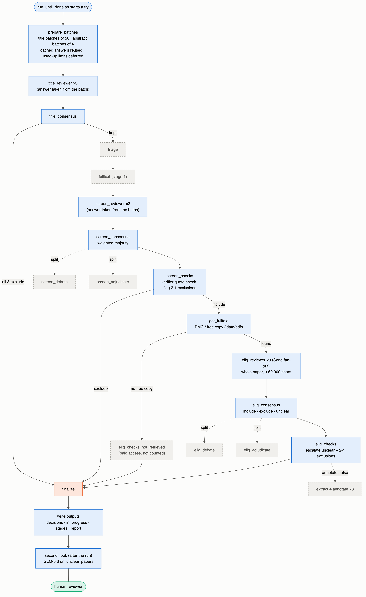

One graph (`src/adrd_review/graph/pipeline.py`) serves every experimental condition; the run config switches steps on and off. In the free run:

| Step | Setting | Status in the free run |
|---|---|---|
| Batch preparation (`prepare_batches` in `runner.py`) | `title_batch: 50`, `abstract_batch: 4` | On: titles and abstracts are judged in batch calls *before* the graph runs; the graph's reviewer nodes take each paper's answer from the batch |
| Title stage | `title_stage: true` | On |
| Triage | `triage: false` | Off (saves a call per paper) |
| Debate / adjudicator | `debate_rounds: 0`, no `adjudicator` | Off (saves calls); splits go to the vote rules in §4 |
| Verifier | `verifier: {enabled: true}` with no model | Quote check only (code, no model) |
| Full text | `eligibility: fulltext`, `eligibility_max_chars: 60000`, `missing_fulltext: not_retrieved` | On; papers without a free copy are recorded as not retrieved and left out |
| Extraction + annotation | `annotate: false` | Off (counts-only run) |
| Human | `human: none` | Escalations are recorded; the professor answers through the stage files |
| Concurrency | `concurrency: 6` | 6 papers at a time |

### 3.2 The complete graph (generated from the code)

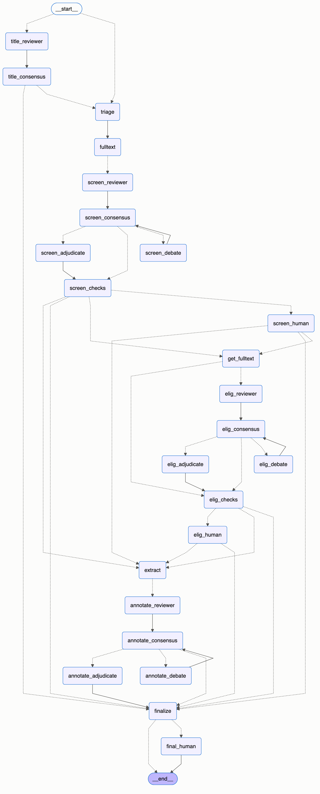

This is `graph.get_graph().draw_mermaid()` of the compiled pipeline for this config: every node the code can route to, including the ones switched off here (dotted edges are conditional). Source: [diagrams/src/langgraph_PROF_search_free.mmd](diagrams/src/langgraph_PROF_search_free.mmd).

### 3.3 How the agents interact

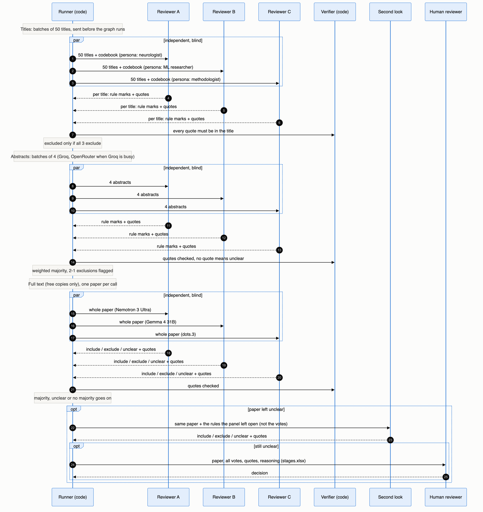

Agents exchange **structured records**, never free chat: each answer is a Pydantic form (`ScreeningAnswer`) with one mark per rule, a quote per mark, a rationale and a confidence. Reviewers run in parallel (LangGraph `Send`) and never see each other's votes. The vote lists in the state use `operator.add` reducers, so parallel reviewers append and nothing is overwritten.

### 3.4 State (`graph/state.py`, as built)

```python
class ArticleState(TypedDict, total=False):
    article: Article                 # carries the full text once fetched (what the reviewers read)
    fulltext_info: dict              # used? source (pmc / oa / pdf)? truncated? or why not found
    prepared: dict                   # votes from batch calls: {"title" | "screening": {reviewer: Vote}}
    title_votes: Annotated[list[Vote], operator.add]
    title_decision: Decision
    screening_votes: Annotated[list[Vote], operator.add]
    screening_decision: Decision
    eligibility_votes: Annotated[list[Vote], operator.add]
    eligibility_decision: Decision   # include / exclude / unclear, method: unanimous / majority / no_majority / not_retrieved
    adjudications, escalations, human_answers: Annotated[list[...], operator.add]
    verification: VerificationReport
    usage: Annotated[list[Usage], operator.add]   # tokens, cost, seconds, cached, actual model per call
    # also: triage, extraction, annotation_votes/decisions, *_round (off in this run)

class Vote(BaseModel):
    reviewer_id: str                 # A | B | C | S (second look)
    model: str                       # the reviewer's configured model (the host that answered is in usage)
    field: str                       # title | screening | eligibility | annotation dimension
    labels: list[str]                # include / exclude / unclear
    rule_checks: dict[str, str]      # I1..E4 -> met / not_met / unclear / applies / does_not_apply
    rule_ids: list[str]              # rules the decision rests on
    evidence: list[EvidenceSpan]     # verbatim quotes, checked against the text
    rationale: str
    confidence: float
    warnings: list[str]              # e.g. a quote not found, so the mark was treated as unclear
```

---

## 4. How decisions are made

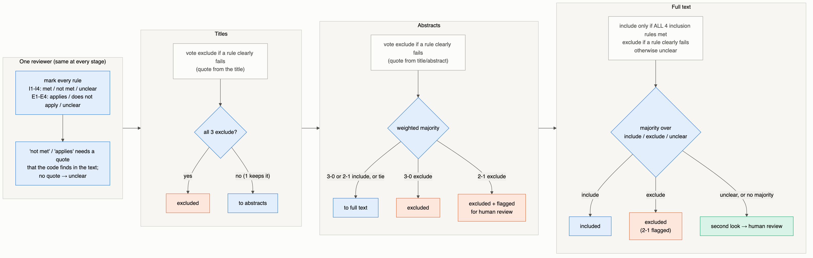

### 4.1 The same at every stage

- Every reviewer marks **every rule**: I1–I4 met / not met / unclear; E1–E4 applies / does not apply / unclear.
- **Excluding needs proof:** "not met" or "applies" must quote the text the reviewer was given. The code searches for each quote; a missing or invented quote turns the mark into "unclear", and "unclear" never excludes.
- Missing marks count as unclear; unknown rule IDs are dropped with a warning.

### 4.2 What differs by stage

| | Titles | Abstracts | Full text (free) |
|---|---|---|---|
| Text read | title only | title + abstract | whole paper (≤ 60,000 characters; methods, participants and results first if longer) |
| One reviewer votes include when | no rule clearly fails | no rule clearly fails | **all four inclusion rules are clearly met**, with quotes |
| One reviewer's answers | include / exclude | include / exclude | include / exclude / **unclear** |
| Panel rule (`consensus.py`) | `combine_title`: excluded only if **all 3** exclude | `combine_screening`: weighted majority; a tie keeps the paper | `combine_eligibility`: majority; no majority → unclear |
| Sent to a person | never (any doubt keeps the paper) | 2-1 exclusions are **flagged** (still excluded) | "unclear" → second look → professor; 2-1 exclusions flagged |

### 4.3 Recall guards

A relevant study is only lost if it is excluded, so exclusions are made hard: unanimity at titles, a quote for every exclusion mark, flags on split exclusions, and no exclusion for lack of information at full text ("unclear" is kept for a person).

### 4.4 Second look (`src/adrd_review/second_look.py`)

Before the result is final, every paper the panel left "unclear" is re-read by **GLM-5.3** (Z.ai), a model family not on the panel:

- It reads the **same full text** the panel read and is told which rules the panel left open (usually I4, age) but **not the panel's votes**.
- It answers with the same form, the same decision rule and the same quote check as a full-text reviewer.
- Outcomes: **included** (every inclusion rule now met, with quotes), **excluded** (a rule clearly fails, with a quote), or **still for human review** (the paper really does not say).
- The run's own decisions are not changed; the result is a separate table, `second_look.csv`, reported as its own step.

---

## 5. Models, hosts and limits

### 5.1 The panel

| Role | Persona | Titles + abstracts | Full text |
|---|---|---|---|
| Reviewer A | clinical neurologist (condition really dementia/AD? older adults?) | `gpt-oss-120b` (OpenAI open weights), reasoning low (titles) / medium (abstracts) | **Nemotron 3 Ultra 550B** (NVIDIA) |
| Reviewer B | machine-learning researcher (really AI/ML? used to detect/diagnose/predict?) | `qwen3.8-27b` (Alibaba) | **Gemma 4 31B** (Google) |
| Reviewer C | research methodologist (original human study? design, data source?) | `gpt-oss-20b` (OpenAI open weights), reasoning low / medium | **dots.3 note preview** (dots-studio) |
| Second look | senior second reviewer | — | **GLM-5.3** (Z.ai) |

Each reviewer uses the **same model for every paper at a stage**: answers already given are reused from the cache, and a model change means new answers for every paper (see §5.3).

### 5.2 Where each model runs

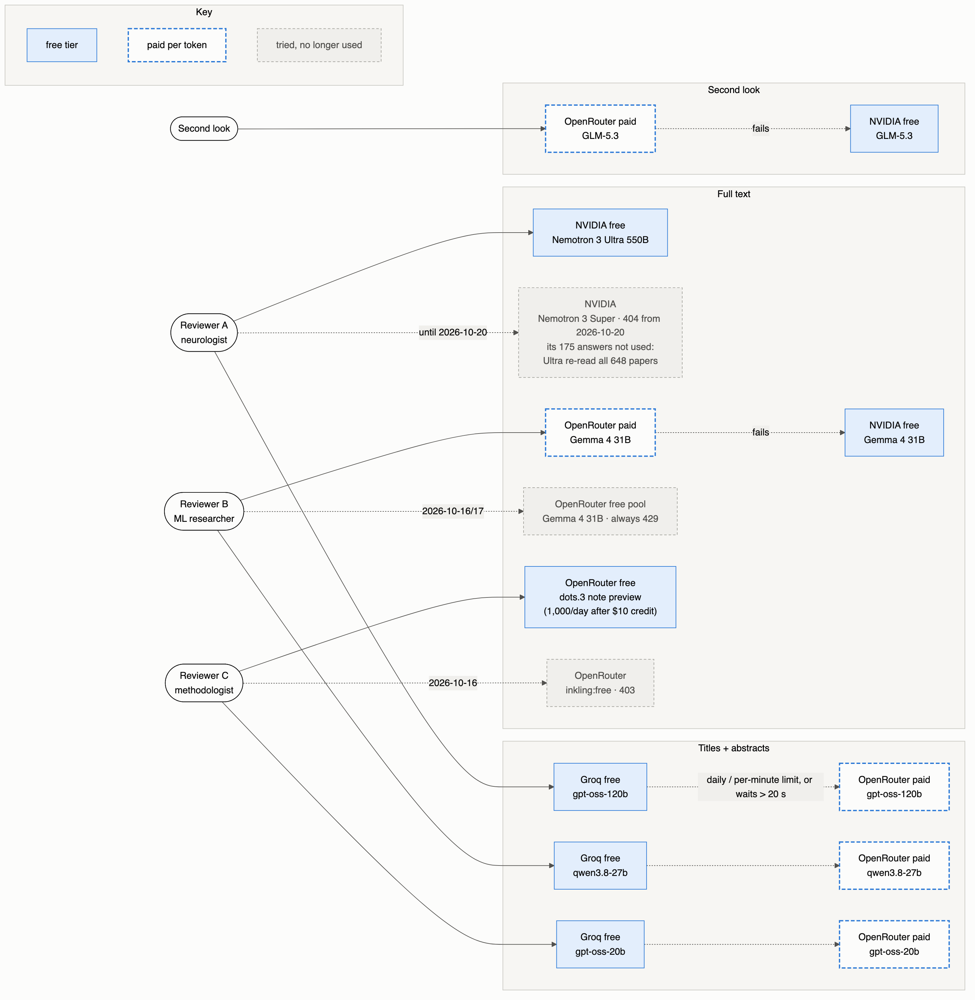

| Host | Used for | Free limits | Paid |
|---|---|---|---|
| **Groq** (free) | titles + abstracts, all three reviewers | per model: 25 requests/min, 8,000 tokens/min, 1,000 requests/day, 200,000 tokens/day | — |
| **OpenRouter** | abstracts when Groq is busy (same three models); B's full text; C's full text (free model); second look | free models: 50 requests/day, **1,000/day after a $10 credit** (added 2026-10-20) | gpt-oss-120b $0.15/$0.60, gpt-oss-20b $0.018/$0.09, qwen3.8-27b $0.04/$1.35, Gemma 4 31B $0.20/$0.40, GLM-5.3 $0.079/$1.40 per M tokens in/out |
| **NVIDIA NIM** (free) | A's full text; B's full-text overflow; second-look overflow | ~40 requests/min per account; slow when busy (minutes per call) | — |

**Overflow** (`ModelConfig.overflow`, `OverflowLLM` in `llm.py`): a model can name a second host for the *same* model. The second host is used when the first one's per-minute budget is busy, when it asks to wait more than 20 seconds, when its daily limit is used up, or when it fails. Answers already cached from either host are reused first, so no request is judged twice. If the overflow host has no credit, the call is deferred, never stopping the run.

### 5.3 Model changes during the run (for the methods section)

| Date | Reviewer / stage | Change | Effect on results |
|---|---|---|---|
| 2026-10-16 | C, full text | `inkling:free` refused for direct API calls (403) → **dots.3** | C had no full-text answers yet |
| 2026-10-17 | B, full text | OpenRouter free Gemma always rate-limited (429) → same Gemma on **NVIDIA** | B had no full-text answers yet |
| 2026-10-20 | A, full text | NVIDIA withdrew **Nemotron 3 Super** (404) after 175 papers → **Nemotron 3 Ultra** | The cache key includes the model, so Ultra re-read **all 648** full texts: every A full-text vote is from Ultra |
| 2026-10-20 | A, B, C, abstracts | the same three models also on **OpenRouter** when Groq is busy | Same models; the host is recorded per call |
| 2026-10-21 | B, full text | NVIDIA's Gemma timed out → same Gemma on **OpenRouter paid** first, NVIDIA as overflow | 348 answers from NVIDIA, 300 from OpenRouter; same model |
| 2026-10-21 | Second look | GLM-5.3 on OpenRouter first, NVIDIA as overflow | New step |

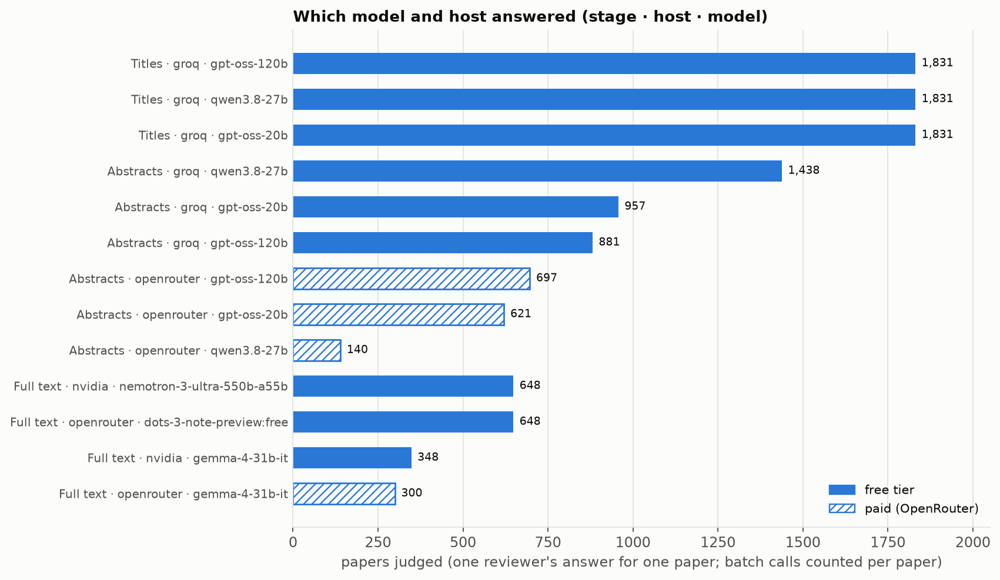

---

## 6. Running unattended on free tiers

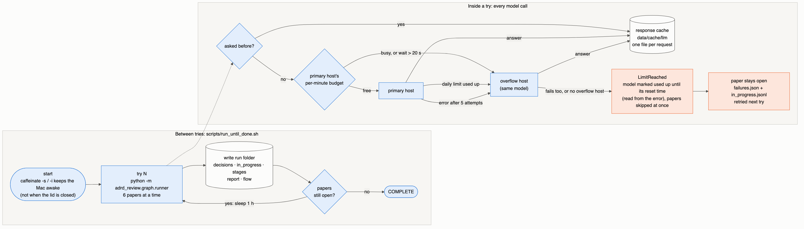

- **Loop** (`scripts/run_until_done.sh`): runs a try, writes the run folder, and if papers are still open, sleeps 1 hour and tries again (240 tries at most). Each try replays finished work from the cache, so only open work costs calls.
- **Cache** (`data/cache/llm/`): one JSON file per request, keyed by a hash of provider, model, settings, answer form and the full prompt. Repeating a request costs nothing.
- **Limits:**
  - our own per-minute limiter (requests and tokens per minute) per model, shared by every role that uses it;
  - a used-up daily limit is read from the provider's error ("try again in 7m30s" from Groq, `X-RateLimit-Reset` from OpenRouter); the model is then marked used up until that time and its papers are skipped at once (`LimitReached`), not retried;
  - no hidden retries in the HTTP client (`max_retries=0`): one hung request had blocked a try for ~30 minutes.
- **Failures never drop a paper:** a paper that fails is recorded in `failures.json`, what it finished so far goes to `in_progress.jsonl`, and the next try picks it up.
- **Keeping the Mac awake:** `caffeinate -s` (on power) and `caffeinate -i` (on battery) for as long as the loop runs. Closing the lid still sleeps the Mac; the timeline below shows how much that cost.

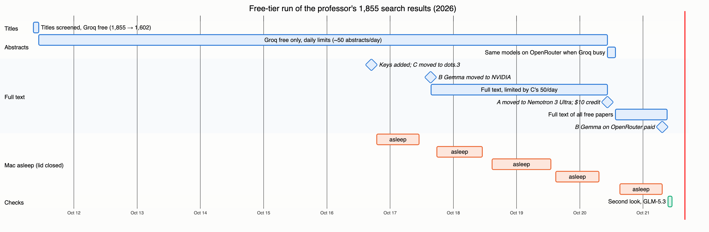

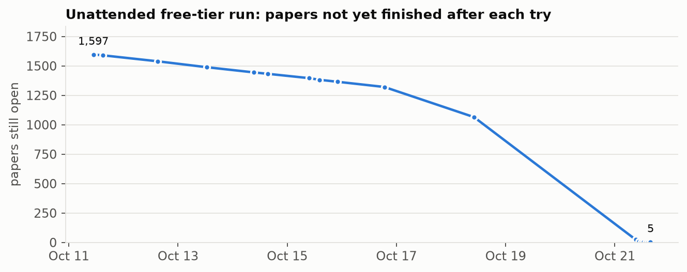

---

## 7. Outputs

Every try writes `data/runs/PROF_search_free/<timestamp>/` (git-ignored, never pushed):

| File | Contents |
|---|---|
| `decisions.jsonl` | one line per finished paper: every vote with rule marks, quotes, rationale; decisions; escalations |
| `in_progress.jsonl` | what each still-open paper finished so far (e.g. its title and abstract decisions while full text waits) |
| `failures.json` | open papers and why (limit, key, error) |
| `predictions.csv` | one row per paper (gold format) |
| `usage.jsonl` | one line per model answer: model and host, tokens, cost, seconds, cached |
| `report.json`, `flow.png` | counts per stage (PRISMA flow), reasons, panel agreement, cost, decision methods |
| `pdfs_needed.csv` | papers without a free full text (kept for the record; not counted) |
| `stages/1_title.csv` … `4_included.csv` | every paper at each stage with outcome, main reason, each reviewer's vote, rule marks, quotes, reasoning; still-open papers listed where they wait |
| `stages/stages.xlsx` | the same as sheets + **random sample** (up to 5 per stage and outcome, fixed seed, free-access papers only) + "how to check"; the AI's columns are hidden so the professor can decide first (blind check) |
| `second_look.csv` | the second look at every paper left for a person |
| `figures/` | the result charts (`python -m adrd_review.eval.report_figures <run>`) |

---

## 8. Final result (2026-10-21; older adults 65+, free full text only)

Built by `src/adrd_review/final_results.py`: every paper gets one outcome and one reason, in the human team's order (titles → abstracts incl. the 65+ age rule → free full text: panel, second look, 65+ age check).

| Stage | In | Excluded | Passed / included | for human review |
|---|---|---|---|---|
| 1. Titles | 1,855 | 253 | 1,602 | — |
| 2. Abstracts | 1,602 | 420 | 1,182 | — |
| 3. Full text (free) | 709 | 143 | **408** | 152 (+6 not finished) |

*Not counted: 163 free copies still to save by hand; 310 paid access only.* The 152: 94 do not report age, 53 cannot be confirmed 65+, 5 have other rules unclear. A **third look** (`third_look.py`, DeepSeek V4.1 Flash, a family used nowhere else) re-read the 185 papers then left for human review and settled 33 (17 included, 16 excluded); 25 could not be re-read when the OpenRouter credit ran out. **Age (65+)** is applied by `age_check.py` at the abstract stage (exclude only when the abstract clearly shows under 65) and at full text (age criterion, youngest/oldest, mean/median with verified quotes; with ages only per group, the youngest group's mean). Paid calls: $10.03 in total (the $10 credit).

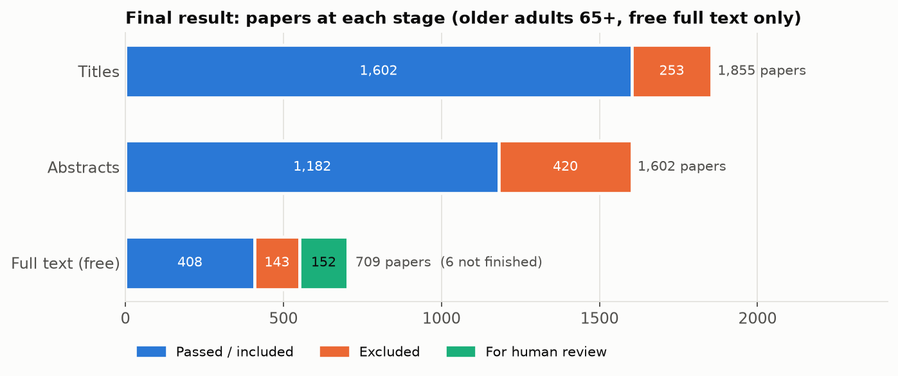

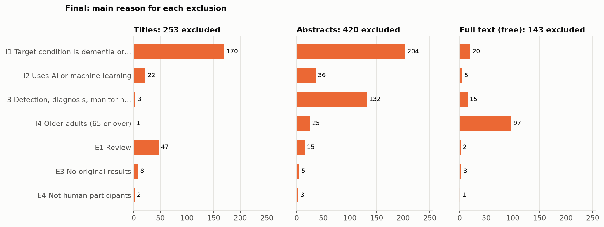

### 8.1 First full pass (try 6, before the 65+ correction; kept for the record)

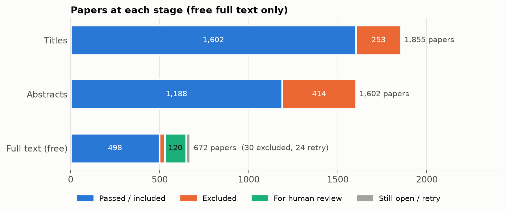

| Stage | In | Excluded | Passed | Other |
|---|---|---|---|---|
| Titles | 1,855 | 253 | 1,602 | — |
| Abstracts | 1,602 | 414 (224 of them 2-1, flagged) | 1,188 | — |
| Full text (free) | 672 | 30 | **498 included** | 120 for a person (second look running) · 24 retry |

*Side note: 516 papers that passed abstracts are paid-access only; they are not assessed and not part of any count or accuracy measure.*

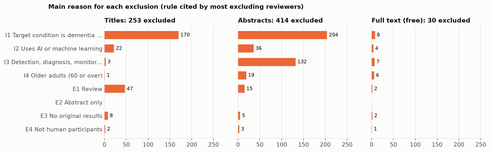

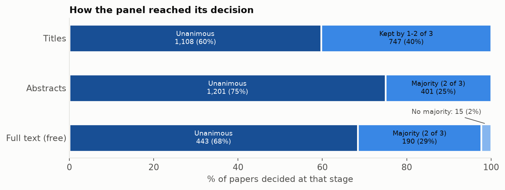

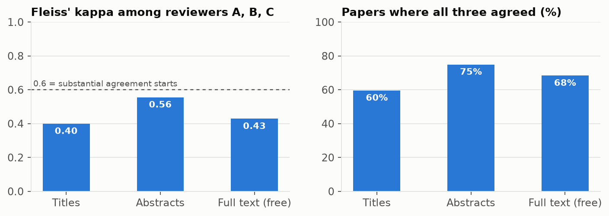

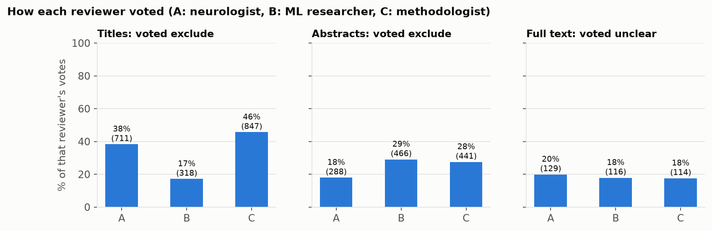

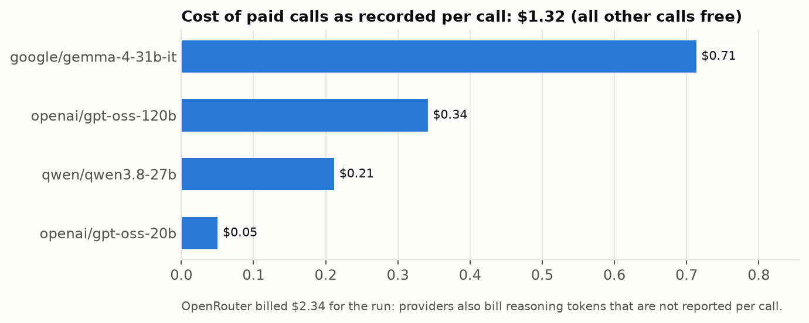

What the numbers say (agreement, not accuracy):

- **I1 (not dementia/AD) is the main filter** at titles (170) and abstracts (204); **I3 (not detection/diagnosis/prediction) appears at abstracts** (132), where the abstract shows what the AI is used for.
- **The reviewers agree only moderately** (Fleiss κ 0.40 titles, 0.56 abstracts, 0.43 full text). At titles, C (gpt-oss-20b) and A (gpt-oss-120b) voted exclude far more often than B (46% and 38% vs 17%); unanimity for exclusion keeps only the clear cases.
- **Most papers left for a person are about age:** 66 of the 120 are open only because the paper does not clearly report participants 60+ (I4); I4 is marked unclear far more than any other rule.
- **Cost:** $2.34 billed by OpenRouter for the run (titles, abstracts and full texts otherwise free).

---

## 9. Evaluation design

### 9.1 What is still needed on this corpus

There is no gold standard for the 1,855 search results, so accuracy here comes from the **professor's blind check** (`stages.xlsx`): she decides from the paper before seeing the AI. Priorities:

1. **Recall:** the 224 abstract exclusions decided 2-1 (where losing a good paper is most likely), plus random excluded papers from each stage.
2. **Precision:** a random sample of the 498 included papers (the inclusion rate, 74% of free full texts, is high).
3. **The age rule:** her answer on unreported age / older-adult datasets (ADNI, NACC) would settle about half of the papers left for a person.

Title and abstract decisions are measured over all screened papers; full-text and final-inclusion measures over free-access papers only.

### 9.2 Metrics (built in `eval/`)

| Aspect | Metric |
|---|---|
| Screening accuracy | precision, recall, F1 (include class), WSS@95 |
| Agreement with humans | Cohen's κ (agents vs gold) |
| Reliability | Fleiss' κ among the 3 agents vs among the 3 humans |
| Human-in-the-loop value | escalation rate; accuracy on auto-accepted vs escalated |
| Efficiency | time, tokens, $ per paper and in total |
| Transparency | share of decisions with verified quotes |
| Run-to-run consistency | κ between repeated runs |
| Error analysis | each disagreement coded: boundary ambiguity / keyword over-emphasis / wrong topic inference / missing information [5] |

### 9.3 Experimental conditions

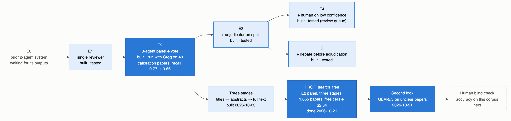

| ID | Condition | Status |
|---|---|---|
| E0 | prior 2-agent system | waiting for its code/outputs |
| E1 | single reviewer | built, tested with the stand-in model |
| E2 | 3-reviewer panel + vote | built; Groq calibration on 40 placeholder papers: recall 0.77, precision 0.77, κ 0.66; **used for human review's search** |
| E3 | + adjudicator on splits | built, tested |
| E4 | + human on low confidence | built, tested (review queue with LangGraph `interrupt()`) |
| D | + debate before adjudication | built, tested |

The placeholder gold standard (Cochrane dementia-screening decisions, CLEF 2017; 268 papers) remains in place for E0–E4/D until the professor's gold file arrives ([GOLD_STANDARD.md](GOLD_STANDARD.md)).

---

## 10. Reproducibility

- Model IDs, sampling settings (temperature 0 where accepted; reasoning effort), personas, limits and hosts are in the run config; each run records the config, codebook and prompt hashes and the git commit (`run_meta.json`).
- Every model answer is cached by a hash of the full request, so a run can be replayed at zero cost and any answer traced.
- The actual model and host behind each answer is in `usage.jsonl`; model changes are listed in §5.3.
- Calibration/test split of the placeholder gold standard frozen with a fixed seed; repeats give mean ± SD.

---

## 11. Repository layout (as built)

```
configs/
  codebook_aiml.yaml       the professor's criteria (v0.3.0)        codebook.yaml  placeholder (CLEF)
  runs/                    run configs (E1-E4, D, PROF_search_*)    prices.yaml    $ per M tokens
  search/  splits/
src/adrd_review/
  agents/                  title_screening, batch, triage, screening, eligibility, extraction, annotation,
                           adjudicator, verifier, debate, human, curator
  graph/                   state.py, pipeline.py (LangGraph), runner.py (batches, runs, outputs)
  llm.py                   model factory, cache, limiter, overflow hosts, fail-fast daily limits
  consensus.py             combine votes per stage; panel agreement
  second_look.py           independent re-read of papers left for a person
  preflight.py             keys, live test calls (incl. overflow hosts), limits, days, cost
  tools/                   pubmed, pmc, pdf, fulltext (source ladder)
  eval/                    metrics, score, flow, stages (per-stage files + blind-check workbook),
                           report_figures (result charts), aggregate, figures, errors, weights, cost, retrieval
scripts/run_until_done.sh  unattended loop (1 h between tries)
docs/diagrams/             rendered diagrams; src/ = Mermaid sources; results/ = charts + their CSVs
data/                      corpus, cache, runs, logs (git-ignored)
tests/                     155 tests
```

---

## 12. Open questions for human review

1. **Age (I4):** should an unreported age, or a dataset of older adults (ADNI, NACC), count as 60+?
2. **Proposed rules:** confirm or change E3 (no original results), E4 (not human) and the mean/median-age part of I4.
3. **Blind check:** sample size and who checks (the workbook supports any seed and size).
4. **Paid-access papers:** the team uses free full text only (516 papers not assessed); confirm this is how the review should report it.
5. **Gold standard and E0:** the original 268-article gold file and the prior system's outputs, for E0-E4 on real data.

---

## References

1. *Debate or Vote: Which Yields Better Decisions in Multi-Agent Large Language Models?* arXiv:2508.17536 (2025). https://arxiv.org/abs/2508.17536
2. Akinseloyin, Jiang, Palade. *LLM-based Multi-Agent Collaboration for Abstract Screening towards Automated Systematic Reviews.* medRxiv 2025.08.11.25333429; published version in PMC. https://pmc.ncbi.nlm.nih.gov/articles/PMC12952526/
3. *Can LLM Agents Really Debate? A Controlled Study of Multi-Agent Debate in Logical Reasoning.* arXiv:2511.07784 (2025). https://arxiv.org/abs/2511.07784
4. *Evaluating human and LLM screening workflows in a conceptually complex scoping review: Recall–workload trade-offs and run-to-run consistency.* arXiv:2608.26885 (2026). https://arxiv.org/abs/2608.26885
5. *Understanding LLMs in Title-Abstract Screening: From Disagreements to Recommendations.* arXiv:2606.17588 (2026). https://arxiv.org/abs/2606.17588
6. LangGraph interrupts / human-in-the-loop documentation. https://docs.langchain.com/oss/python/langgraph/interrupts
