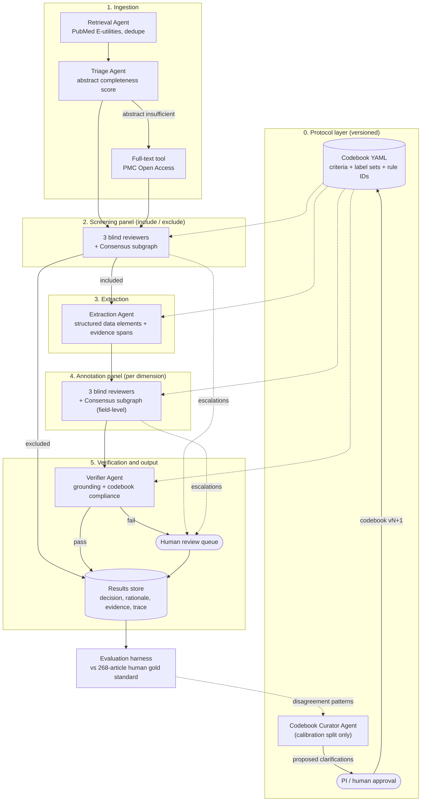
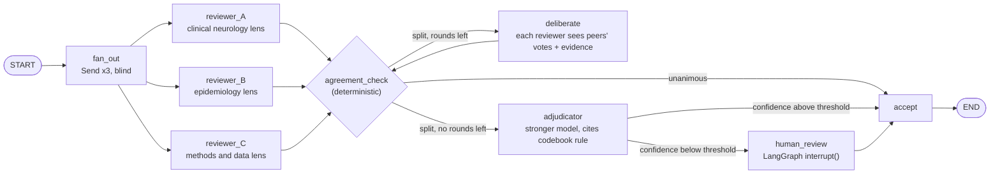
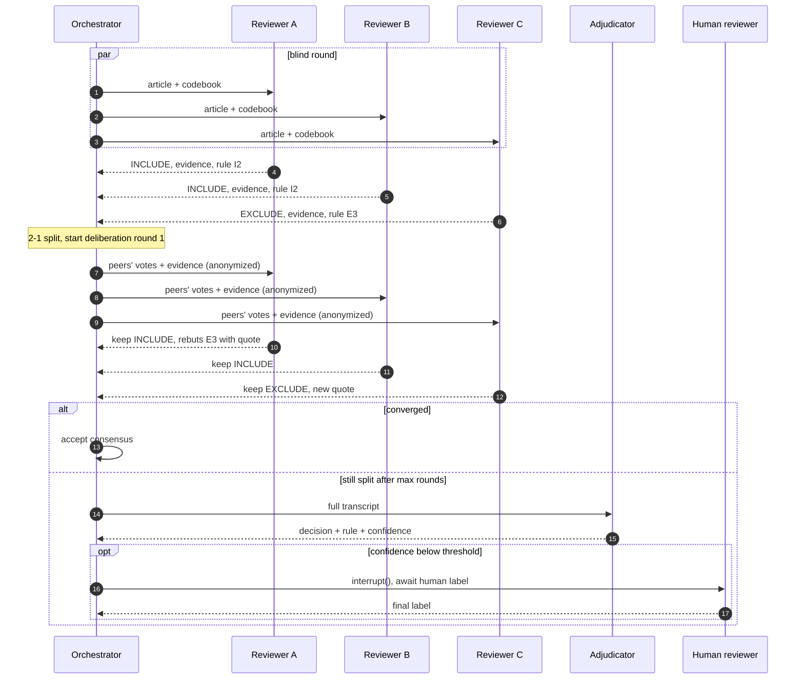
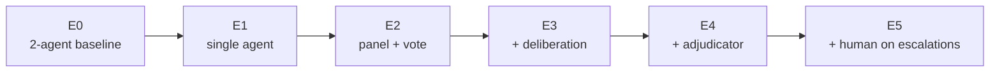

# Multi-Agent Scoping Review of ADRD Screening Literature — Architecture

> Status: **design proposal (v0.1)**. The human gold standard (3 reviewers, 268 articles) is complete.
> This document describes the agent side: a LangGraph multi-agent system whose output is evaluated against that gold standard.

---

## 1. Why a multi-agent design, and what it must fix

The prior system (LangChain + Django REST) used **two sequential agents**: an Extraction Agent and an Annotation Agent. It was ~47.7× faster than the human team with strong classification performance, but the Annotation Agent struggled in specific places. The new design addresses each one directly:

| Weakness observed in the 2-agent system | Design response in this architecture |
|---|---|
| Nuanced contextual judgment | **Independent reviewer panel** (3 agents with different perspectives, run blind) instead of a single annotator. Disagreement becomes a signal, not a hidden error. |
| Borderline studies | **Structured deliberation + Adjudicator**. Split votes trigger an evidence-based debate. Items still unresolved are routed to a human. |
| Domain-specific expertise | **Specialist tools** (screening-instrument lexicon, ADRD dataset registry, MeSH lookup) available to every reviewer, plus perspective-specific system prompts. |
| Iterative refinement of criteria | **Versioned codebook + Codebook Curator agent** that mines disagreement patterns on a *calibration split* and proposes clarifications for the PI to approve. |
| Variable abstract reporting quality | **Triage agent** scores abstract completeness and pulls PMC Open Access full text when the abstract is insufficient. |
| Need for human-in-the-loop and transparency | Every decision stores **rationale + verbatim evidence spans + codebook rule IDs**. A Verifier checks grounding. LangGraph `interrupt()` provides a human review queue. |

**Core principle:** the agent side should *mirror the human protocol* (independent dual/triple review → reconciliation → adjudication). That makes the agent-vs-human comparison methodologically clean, including inter-rater reliability.

---

## 2. System overview



The **Consensus subgraph** is the heart of the design. The same subgraph is reused for screening (article-level) and annotation (field-level).

---

## 3. The Consensus subgraph (how agents talk to each other)

### 3.1 Graph



### 3.2 Communication protocol

Agents do **not** chat freely. They exchange **structured messages** on a shared blackboard (the LangGraph state). This keeps the process auditable and prevents the loudest agent from dominating.

1. **Blind round (independence).** Each reviewer sees only the article and the codebook, never the other votes. This mirrors independent human review and keeps inter-agent agreement statistics meaningful.
2. **Agreement check (code, not an LLM).** Unanimous → accept. Otherwise → deliberate. For annotation, the check is **per field**, so only disputed dimensions are debated.
3. **Deliberation (max 2 rounds).** Each reviewer receives the other reviewers' votes, rationales and evidence quotes (anonymized as "Reviewer 1/2"). It may keep or revise its vote, but **a revision must cite a new evidence span or codebook rule**. A change that cites nothing is rejected. This guards against sycophantic conformity.
4. **Adjudication.** If the vote is still split, the Adjudicator reads the full transcript and issues a final decision, the codebook rule it relied on, and a confidence score.
5. **Escalation.** Low-confidence adjudications, and anything the Verifier fails, go to a human queue. This is the human-in-the-loop protocol from the paper's recommendations.



### 3.3 Panel diversity

Three agents built on the same model and prompt tend to fail in the same way. Diversity comes from two knobs, and each is an experimental factor (see §7):

- **Perspective diversity:** the same model with different system prompts (clinical neurology, epidemiology/population, research methods/data source).
- **Model diversity:** different model families per reviewer (for example one frontier closed model, one other-vendor closed model, one open-weights model).

---

## 4. Agent roster

| Agent | Role | Input → Output | Tools | Model tier |
|---|---|---|---|---|
| **Retrieval** | Run the PubMed query, dedupe, fetch metadata and abstracts | query → `Article[]` | PubMed E-utilities (esearch/efetch) | small |
| **Triage** | Score abstract completeness against codebook fields and request full text when needed | `Article` → `TriageReport` | PMC OA full-text fetch | small |
| **Screening Reviewer ×3** | Include/exclude decision per codebook criteria | `Article` → `ScreeningVote` | MeSH lookup | mid, diverse |
| **Extraction** | Capture key data elements with verbatim evidence spans | `Article` → `ExtractionRecord` | none (structured output) | mid |
| **Annotation Reviewer ×3** | Label each dimension (instrument type, target population, dataset source, …) | `Article` + `ExtractionRecord` → `AnnotationVote` | instrument lexicon, dataset registry | mid, diverse |
| **Adjudicator** | Resolve split votes after deliberation | transcript → `Decision` | codebook | strongest |
| **Verifier** | (a) deterministic check that each evidence quote exists in the source; (b) LLM check that the label follows from the cited rule | `Decision` → pass/fail | fuzzy string match | mid |
| **Codebook Curator** | Cluster disagreements on the **calibration split** and propose codebook clarifications | disagreement log → proposal | none | strongest |
| **Orchestrator** | The LangGraph graph itself: routing, fan-out, retries, budgets | — | — | none (code) |

> The Retrieval agent's recall is evaluated **separately** (did the search recover the 268 human-reviewed articles?). For the head-to-head screening and annotation comparison, the pipeline runs on the **fixed 268-article corpus**, so retrieval noise does not confound the result.

---

## 5. LangGraph implementation mapping

| Concept | LangGraph mechanism |
|---|---|
| Per-article pipeline | `StateGraph` compiled once, invoked per article. An outer async batch runner applies a concurrency limit. |
| Parallel blind reviewers | `Send` API fan-out → reducer (`operator.add`) collects votes |
| Deliberation loop | conditional edge from `agreement_check`, with `round` counter in state |
| Reuse across stages | Consensus is a **compiled subgraph**, parameterized by task (`screening` / `annotation`) |
| Human-in-the-loop | `interrupt()` in `human_review` node + checkpointer. The review UI resumes with `Command(resume=...)`. |
| Resumability and audit | `SqliteSaver` locally, `PostgresSaver` for shared runs. Every step is checkpointed. |
| Structured outputs | Pydantic models via `.with_structured_output()` |
| Tracing and transparency | LangSmith or Langfuse (self-hostable) with the trace ID stored alongside each decision |
| API + reviewer UI | Reuse **Django REST** from the prior system to expose runs and the human review queue |

### 5.1 State schema (sketch)

```python
class EvidenceSpan(BaseModel):
    quote: str                      # must appear verbatim in source
    source: Literal["title", "abstract", "fulltext"]

class Vote(BaseModel):
    reviewer_id: str                # "A" | "B" | "C"
    round: int                      # 0 = blind
    field: str                      # "screening" or an annotation dimension
    label: str | list[str]
    rule_ids: list[str]             # codebook rules relied on
    evidence: list[EvidenceSpan]
    rationale: str
    confidence: float               # self-report; logged, not trusted alone

class ArticleState(TypedDict):
    pmid: str
    article: Article
    triage: TriageReport | None
    codebook_version: str
    screening_votes: Annotated[list[Vote], operator.add]
    screening_decision: Decision | None
    extraction: ExtractionRecord | None
    annotation_votes: Annotated[list[Vote], operator.add]
    annotation_decisions: dict[str, Decision]   # per dimension
    round: int
    escalations: Annotated[list[str], operator.add]
    cost: Annotated[list[Usage], operator.add]  # tokens, $ and wall time per node
```

---

## 6. Reproducibility requirements

- Pin **exact model version IDs**. Use temperature 0 where supported and record all sampling parameters.
- The codebook, prompts and panel config are **versioned files**, and each run records their hashes.
- Cache every LLM request/response (keyed by prompt hash) so runs can be replayed at zero cost.
- Split the 268 articles once with a fixed seed: **calibration split** (e.g., ~40 articles) for prompt and codebook iteration, and a **held-out test split** (~228) that is touched only for final numbers. The Codebook Curator never sees test-split labels.
- Repeat each experimental condition ≥3 times and report mean ± SD, since LLM output is not fully deterministic.

---

## 7. Evaluation design

### 7.1 Metrics

| Aspect | Metric |
|---|---|
| Screening accuracy | Precision, recall, F1 (include class), **WSS@95** (work saved over sampling) |
| Annotation accuracy | Per-dimension and macro/micro precision, recall, F1 |
| Agreement with humans | **Cohen's κ** (agent final vs human gold) |
| Reliability | **Fleiss' κ among the 3 agents** (blind round) vs **Fleiss' κ among the 3 humans**, a direct like-for-like comparison |
| Deliberation effect | Flip rate. Share of flips *toward* gold vs *away* from gold (conformity check) |
| Human-in-the-loop value | Escalation rate. Accuracy on auto-accepted items vs escalated items (coverage–accuracy curve) |
| Efficiency | Wall-clock time-to-completion, tokens, $ cost, per article and total. Compare to the 47.7× result. |
| Transparency | % of decisions with verified evidence spans (Verifier pass rate) |

### 7.2 Experimental conditions (ablation ladder)

| ID | Condition | Answers the question |
|---|---|---|
| E0 | Prior 2-agent system (existing results) | baseline |
| E1 | Single reviewer agent, new codebook | Does the codebook/prompting alone help? |
| E2 | 3-agent panel, majority vote, **no talking** | Value of redundancy |
| E3 | E2 + deliberation | Value of agents talking to each other |
| E4 | E3 + Adjudicator | Value of a senior arbiter |
| E5 | E4 + human review of escalations | Accuracy vs. human effort trade-off |

Crossed factors: **homogeneous vs heterogeneous models**, **abstract-only vs triage + full text**, **specialist-per-dimension vs generalist annotators**.



---

## 8. Build plan

| Phase | Deliverable | Exit criterion |
|---|---|---|
| 1. Data & codebook | Gold standard loaded, codebook YAML formalized with rule IDs, calibration/test split frozen | Codebook reproduces the human labels' vocabulary exactly |
| 2. Eval harness first | Metrics module (P/R/F1, Cohen/Fleiss κ, WSS@95, cost/time) run against E0 outputs | Reproduces the published E0 numbers |
| 3. Single agent (E1) | LangGraph pipeline: triage → screen → extract → annotate | Full run on calibration split |
| 4. Panel (E2) | `Send` fan-out, reducer, agreement check | Fleiss κ reported for agents |
| 5. Deliberation + adjudicator (E3–E4) | Consensus subgraph with round limit and evidence-required revisions | Flip analysis available |
| 6. HITL + Verifier + Curator (E5) | `interrupt()` queue exposed via Django REST, grounding checks | End-to-end run on test split |
| 7. Ablations & write-up | All conditions × repeats | Paper tables and figures |

---

## 9. Proposed repository layout

```
adrd-multiagent-review/
├── configs/
│   ├── codebook.yaml        # criteria, label sets, rule IDs (versioned)
│   └── panel.yaml           # reviewer personas + model assignments
├── src/adrd_review/
│   ├── agents/              # one module per agent (prompt + structured output)
│   ├── tools/               # pubmed, pmc_fulltext, instrument_lexicon, dataset_registry
│   ├── graph/               # state.py, consensus_subgraph.py, pipeline.py, runner.py
│   └── eval/                # metrics.py, kappa.py, wss.py, reports.py
├── data/                    # git-ignored: gold/, corpus/, runs/
├── notebooks/               # analysis and figures
├── tests/
└── docs/ARCHITECTURE.md
```

---

## 10. Open questions for the PI

1. **Gold-standard contents.** Does it hold screening decisions for all 268 articles, annotations for the included subset, or both? What are the complete label sets for every annotation dimension (the "etc." in the abstract)?
2. **Individual vs consensus human labels.** Were each reviewer's individual labels kept? They are required for the human Fleiss' κ comparison.
3. **Baseline reuse.** Is the prior 2-agent code, with its prompts and outputs, available to serve as E0 and to validate the eval harness?
4. **Models and budget.** Which LLM providers are approved, and what is the budget? Is an open-weights model required for reproducibility?
5. **Full text.** Is using PMC Open Access full text in scope, or must the comparison be abstract-only to match the human protocol?
6. **Timing comparability.** How was human time-to-completion measured, so agent timing can be reported on the same basis?
