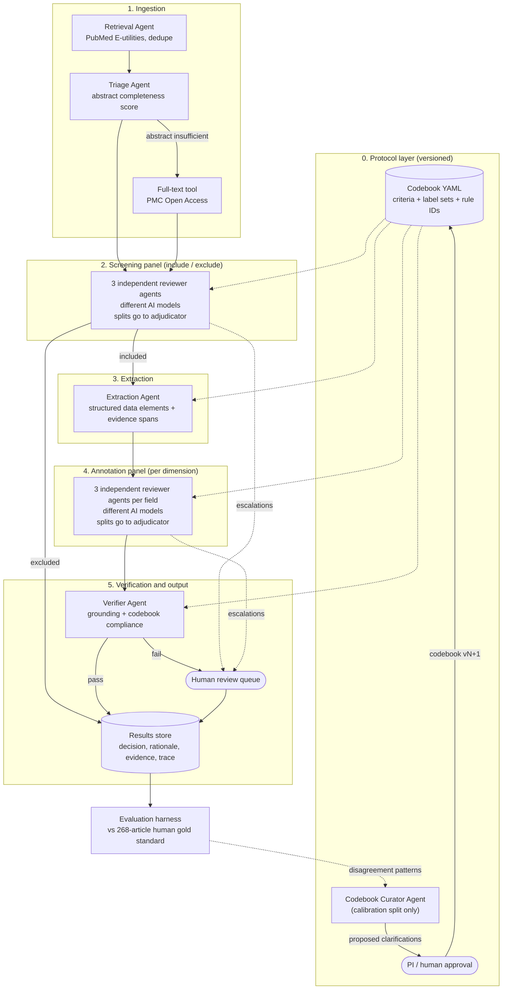
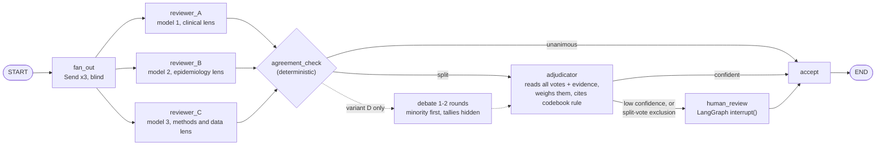
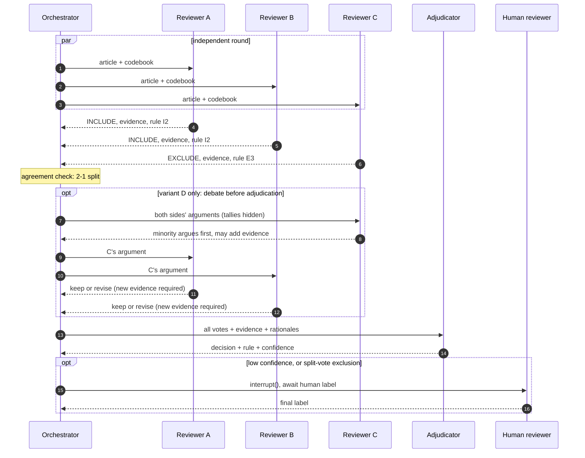
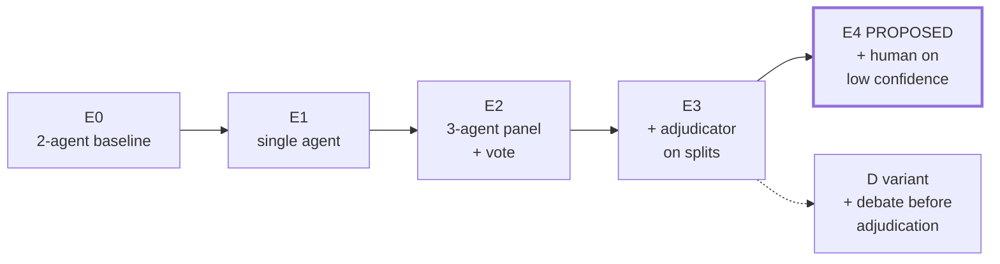

# Multi-Agent Scoping Review of ADRD Screening Literature — Architecture

> Status: **design proposal (v0.3)**. The human gold standard (3 reviewers, 268 articles) is complete.
> This document describes the agent side: a LangGraph multi-agent system whose output is evaluated against that gold standard.

---

## 1. Why a multi-agent design, and what it must fix

The prior system (LangChain + Django REST) used **two sequential agents**: an Extraction Agent and an Annotation Agent. It was ~47.7× faster than the human team with strong classification performance, but the Annotation Agent struggled in specific places. The new design addresses each one directly:

| Weakness observed in the 2-agent system | Design response in this architecture |
|---|---|
| Nuanced contextual judgment | **Panel of 3 independent reviewer agents on different AI models** instead of a single annotator. When they disagree, that disagreement flags a hard case instead of hiding an error. |
| Borderline studies | **Adjudicator agent** resolves split decisions by weighing all reviewers' evidence. Low-confidence cases go to a **human**. |
| Domain-specific expertise | **Specialist tools** (screening-instrument lexicon, ADRD dataset registry, MeSH lookup) available to every reviewer, plus perspective-specific system prompts. |
| Iterative refinement of criteria | **Versioned codebook + Codebook Curator agent** that mines disagreement patterns on a *calibration split* and proposes clarifications for the PI to approve. |
| Variable abstract reporting quality | **Triage agent** scores abstract completeness and pulls PMC Open Access full text when the abstract is insufficient. |
| Need for human-in-the-loop and transparency | Every decision stores **rationale + verbatim evidence spans + codebook rule IDs**. A Verifier checks grounding. LangGraph `interrupt()` provides a human review queue. |

**Core principle:** the agent side should *mirror the human protocol* (independent review by 3 reviewers → reconciliation → adjudication). That makes the agent-vs-human comparison methodologically clean, including inter-rater reliability.

### 1.1 What prior work says, and how it shaped this design

| Finding | Design consequence |
|---|---|
| Across benchmarks, multi-agent debate rarely beats plain majority voting. Most of the gain comes from combining several models, not from the debate itself [1]. | Disagreements are resolved by **independent votes + an adjudicator**, not by open-ended debate. Debate is tested as an optional variant (D) and adopted only if it wins on the calibration split. |
| For LLM abstract screening specifically, soft majority voting across *different model families* was the best strategy. Debate made models converge and lose diversity, which hurt [2]. | **Each reviewer runs on a different model family.** Reviewers never see each other's answers before voting. |
| An adjudicator that *weights* reviewer scores beat one that *picks* a single answer [2]. | **The Adjudicator weighs all reviewers' positions and evidence**; it does not simply override them. |
| Majority pressure suppresses correct minority agents: weak models corrected an incorrect majority only 3.6% of the time, strong models 30–34% [3]. | If the debate variant is used, it has **anti-conformity rules** (hidden tallies, minority first, evidence required to change a vote). Reviewers should be reasonably strong models. |
| In a complex scoping review, two identical LLM runs differed on 94 of 1,131 records, 29 of them eligible. The authors advise against autonomous exclusion [4]. | **Recall guard at screening:** no article is auto-excluded unless *all* reviewers exclude it. Run-to-run consistency is a reported metric. |
| LLM-human disagreement stems mainly from boundary ambiguity in criteria, keyword over-emphasis and wrong topic inference (κ 0.52–0.77) [5]. | **Codebook entries carry definitions and boundary examples**, and errors are coded with this taxonomy during analysis. |

---

## 2. System overview



The **Consensus subgraph** (§3) is the heart of the design. The same subgraph is reused for screening (article-level) and annotation (field-level).

---

## 3. The Consensus subgraph: combining the reviewers' decisions

### 3.1 Graph



Solid arrows are the recommended system. The dotted path is the debate variant (D), which is tested but not assumed.

### 3.2 How the agents interact

Agents exchange **structured records** (vote, evidence quotes, codebook rule IDs, rationale) on a shared blackboard, which is the LangGraph state. There is no free-form chat. This keeps every decision auditable.

1. **Independent round.** Each reviewer sees only the article and the codebook, never the other votes. This mirrors independent human review and keeps inter-agent agreement statistics meaningful. It also preserves the model diversity that drives most of a panel's accuracy gain [1][2].
2. **Agreement check (code, not an LLM).** Unanimous → accept. Split → adjudicator. For annotation, the check is **per field**, so only disputed dimensions go further.
3. **Adjudication.** The Adjudicator (the strongest model) reads every reviewer's vote, evidence and rationale. It weighs those positions rather than starting over [2], and returns a decision, the codebook rule it relied on, and a confidence score.
4. **Escalation.** Low-confidence adjudications, split-vote screening exclusions (§3.4), and anything the Verifier fails go to a human queue. This is the human-in-the-loop protocol from the paper's recommendations.

**Debate variant (D, tested, not assumed).** Before adjudication, split reviewers get 1–2 rounds to respond to each other. The anti-conformity rules [3]:
- Arguments are shown without vote counts.
- The minority argues first.
- A vote can change only by citing new evidence or a codebook rule.
- Independent-round votes are never overwritten.

Prior work shows debate usually does not beat voting [1][2]. Our failure mode, nuanced ADRD annotation, is exactly where it might help, so D is tested and kept only if it wins on the calibration split.



### 3.3 Panel diversity

Three agents built on the same model tend to fail in the same way. In prior screening work, the benefit of a panel came from **model diversity** [2]. Diversity has two knobs:

- **Model diversity (default):** a different model family per reviewer, for example two different-vendor closed models and one open-weights model.
- **Perspective diversity:** different system prompts on each reviewer (clinical neurology, epidemiology/population, research methods/data source). This is layered on top of model diversity by default. A persona-only panel (one model, three prompts) is an ablation.

### 3.4 Screening vs annotation use different decision rules

- **Screening (recall matters most).** Missing an eligible study is worse than reviewing an extra one. An article is auto-excluded **only if all reviewers exclude it**. If the vote is split and the adjudicator says exclude, a human confirms it. Split votes never become silent exclusions [4].
- **Annotation (balanced accuracy).** Unanimous fields are accepted. Split fields go to the adjudicator, and low-confidence ones go to a human.

### 3.5 Panel size

Three reviewers mirror the three human reviewers and are the main condition. Panel size (3 / 5 / 7, always odd) is an experimental factor, used to find where accuracy stops improving relative to cost.

---

## 4. Agent roster

8 agent roles; with 3-reviewer panels, about 12 agent instances work on each article.

| Agent | Role | Input → Output | Tools | Model tier |
|---|---|---|---|---|
| **Retrieval** | Run the PubMed query, dedupe, fetch metadata and abstracts | query → `Article[]` | PubMed E-utilities (esearch/efetch) | small |
| **Triage** | Score abstract completeness against codebook fields and request full text when needed | `Article` → `TriageReport` | PMC OA full-text fetch | small |
| **Screening Reviewer ×3** | Include/exclude decision per codebook criteria | `Article` → `ScreeningVote` | MeSH lookup | mid–strong, different models |
| **Extraction** | Capture key data elements with verbatim evidence spans | `Article` → `ExtractionRecord` | none (structured output) | mid |
| **Annotation Reviewer ×3** | Label each dimension (instrument type, target population, dataset source, …) | `Article` + `ExtractionRecord` → `AnnotationVote` | instrument lexicon, dataset registry | mid–strong, different models |
| **Adjudicator** | Resolve split votes by weighing all reviewers' positions and evidence | votes + evidence → `Decision` | codebook | strongest |
| **Verifier** | (a) deterministic check that each evidence quote exists in the source; (b) LLM check that the label follows from the cited rule | `Decision` → pass/fail | fuzzy string match | mid |
| **Codebook Curator** | Cluster disagreements on the **calibration split** and propose codebook clarifications | disagreement log → proposal | none | strongest |
| **Orchestrator** | The LangGraph graph itself: routing, fan-out, retries, budgets | — | — | none (code) |

> The Retrieval agent's recall is evaluated **separately** (did the search recover the 268 human-reviewed articles?). For the head-to-head screening and annotation comparison, the pipeline runs on the **fixed 268-article corpus**, so retrieval noise does not confound the result.

---

## 5. LangGraph implementation mapping

| Concept | LangGraph mechanism |
|---|---|
| Per-article pipeline | `StateGraph` compiled once, invoked per article. An outer async batch runner applies a concurrency limit. |
| Parallel independent reviewers | `Send` API fan-out → reducer (`operator.add`) collects votes |
| Split routing | conditional edge from `agreement_check` to `adjudicator` (or, in variant D, to `debate` with a `round` counter) |
| Reuse across stages | Consensus is a **compiled subgraph**, parameterized by task (`screening` / `annotation`) |
| Human-in-the-loop | `interrupt()` in `human_review` node + checkpointer. The review UI resumes with `Command(resume=...)`. |
| Resumability and audit | `SqliteSaver` locally, `PostgresSaver` for shared runs. Every step is checkpointed. |
| Structured outputs | Pydantic models via `.with_structured_output()` |
| Tracing and transparency | LangSmith or Langfuse (self-hostable) with the trace ID stored alongside each decision |
| API + reviewer UI | Reuse **Django REST** from the prior system to expose runs and the human review queue |

### 5.1 State schema (sketch)

```python
class EvidenceSpan(BaseModel):
    quote: str                      # must appear verbatim in source
    source: Literal["title", "abstract", "fulltext"]

class Vote(BaseModel):
    reviewer_id: str                # "A" | "B" | "C"
    round: int                      # 0 = independent round; >0 only in variant D
    field: str                      # "screening" or an annotation dimension
    label: str | list[str]
    rule_ids: list[str]             # codebook rules relied on
    evidence: list[EvidenceSpan]
    rationale: str
    confidence: float               # self-report; logged, not trusted alone

class ArticleState(TypedDict):
    pmid: str
    article: Article
    triage: TriageReport | None
    codebook_version: str
    screening_votes: Annotated[list[Vote], operator.add]
    screening_decision: Decision | None
    extraction: ExtractionRecord | None
    annotation_votes: Annotated[list[Vote], operator.add]
    annotation_decisions: dict[str, Decision]   # per dimension
    round: int
    escalations: Annotated[list[str], operator.add]
    cost: Annotated[list[Usage], operator.add]  # tokens, $ and wall time per node
```

---

## 6. Reproducibility requirements

- Pin **exact model version IDs**. Use temperature 0 where supported and record all sampling parameters.
- The codebook, prompts and panel config are **versioned files**, and each run records their hashes.
- Cache every LLM request/response (keyed by prompt hash) so runs can be replayed at zero cost.
- Split the 268 articles once with a fixed seed: **calibration split** (e.g., ~40 articles) for prompt and codebook iteration, and a **held-out test split** (~228) that is touched only for final numbers. The Codebook Curator never sees test-split labels.
- Repeat each experimental condition ≥3 times and report mean ± SD, since LLM output is not fully deterministic.

---

## 7. Evaluation design

### 7.1 Metrics

| Aspect | Metric |
|---|---|
| Screening accuracy | Precision, recall, F1 (include class), **WSS@95** (work saved over sampling) |
| Annotation accuracy | Per-dimension and macro/micro precision, recall, F1 |
| Agreement with humans | **Cohen's κ** (agent final vs human gold) |
| Reliability | **Fleiss' κ among the 3 agents** (independent round) vs **Fleiss' κ among the 3 humans**, a direct like-for-like comparison |
| Human-in-the-loop value | Escalation rate. Accuracy on auto-accepted items vs escalated items (coverage–accuracy curve) |
| Efficiency | Wall-clock time-to-completion, tokens, $ cost, per article and total. Compare to the 47.7× result. |
| Transparency | % of decisions with verified evidence spans (Verifier pass rate) |
| Run-to-run consistency | Cohen's κ between repeated identical runs, plus the number of eligible studies that only one run kept [4] |
| Error analysis | Each disagreement with gold coded as boundary ambiguity / keyword over-emphasis / wrong topic inference / abstract missing information [5] |
| Debate effect (variant D only) | Vote-change rate. Share of changes *toward* gold vs *away* from gold (conformity check) |

### 7.2 Experimental conditions

**E4 is the proposed system.** E0–E3 show what each added part contributes, and D tests whether agent-to-agent debate adds anything.

| ID | Condition | Role | Answers the question |
|---|---|---|---|
| E0 | Prior 2-agent system (existing results) | baseline | Where we started |
| E1 | Single reviewer agent, new pipeline + codebook | baseline | Does the codebook/pipeline alone help? |
| E2 | 3-agent panel (different models), weighted majority vote | baseline | Value of multiple independent agents |
| E3 | E2, but split votes go to the Adjudicator | ablation | Value of an evidence-weighing arbiter over a plain vote |
| **E4** | **E3 + human review of low-confidence items** | **proposed system** | Final accuracy vs. human effort |
| D | E3 with 1–2 debate rounds before adjudication | variant | Does agent-to-agent debate help on nuanced ADRD annotation? |

Crossed factors: **different-model vs single-model (persona-only) panel**, **panel size 3 / 5 / 7**, **abstract-only vs triage + full text**, **specialist-per-dimension vs generalist annotators**.



---

## 8. Build plan

| Phase | Deliverable | Exit criterion |
|---|---|---|
| 1. Data & codebook | Gold standard loaded, codebook YAML formalized with rule IDs, calibration/test split frozen | Codebook reproduces the human labels' vocabulary exactly |
| 2. Eval harness first | Metrics module (P/R/F1, Cohen/Fleiss κ, WSS@95, cost/time) run against E0 outputs | Reproduces the published E0 numbers |
| 3. Single agent (E1) | LangGraph pipeline: triage → screen → extract → annotate | Full run on calibration split |
| 4. Panel (E2) | `Send` fan-out, reducer, agreement check, weighted vote | Fleiss κ reported for agents |
| 5. Adjudicator + HITL (E3–E4) | Adjudicator node, `interrupt()` queue exposed via Django REST, Verifier grounding checks | End-to-end run on calibration split |
| 6. Debate variant (D) + Curator | Debate loop with anti-conformity rules; Codebook Curator on calibration split | D vs E3 compared on calibration split |
| 7. Final runs & write-up | All conditions × repeats on the test split | Paper tables and figures |

---

## 9. Proposed repository layout

```
adrd-multiagent-review/
├── configs/
│   ├── codebook.yaml        # criteria, label sets, rule IDs (versioned)
│   └── panel.yaml           # reviewer personas + model assignments
├── src/adrd_review/
│   ├── agents/              # one module per agent (prompt + structured output)
│   ├── tools/               # pubmed, pmc_fulltext, instrument_lexicon, dataset_registry
│   ├── graph/               # state.py, consensus_subgraph.py, pipeline.py, runner.py
│   └── eval/                # metrics.py, kappa.py, wss.py, reports.py
├── data/                    # git-ignored: gold/, corpus/, runs/
├── notebooks/               # analysis and figures
├── tests/
└── docs/ARCHITECTURE.md
```

---

## 10. Open questions for the PI

1. **Gold-standard contents.** Does it hold screening decisions for all 268 articles, annotations for the included subset, or both? What are the complete label sets for every annotation dimension (the "etc." in the abstract)?
2. **Individual vs consensus human labels.** Were each reviewer's individual labels kept? They are required for the human Fleiss' κ comparison.
3. **Baseline reuse.** Is the prior 2-agent code, with its prompts and outputs, available to serve as E0 and to validate the eval harness?
4. **Models and budget.** Which LLM providers are approved, and what is the budget? Is an open-weights model required for reproducibility?
5. **Full text.** Is using PMC Open Access full text in scope, or must the comparison be abstract-only to match the human protocol?
6. **Timing comparability.** How was human time-to-completion measured, so agent timing can be reported on the same basis?

---

## References

1. *Debate or Vote: Which Yields Better Decisions in Multi-Agent Large Language Models?* arXiv:2508.17536 (2025). https://arxiv.org/abs/2508.17536
2. Akinseloyin, Jiang, Palade. *LLM-based Multi-Agent Collaboration for Abstract Screening towards Automated Systematic Reviews.* medRxiv 2025.08.11.25333429; published version in PMC. https://pmc.ncbi.nlm.nih.gov/articles/PMC12952526/
3. *Can LLM Agents Really Debate? A Controlled Study of Multi-Agent Debate in Logical Reasoning.* arXiv:2511.07784 (2025). https://arxiv.org/abs/2511.07784
4. *Evaluating human and LLM screening workflows in a conceptually complex scoping review: Recall–workload trade-offs and run-to-run consistency.* arXiv:2608.26885 (2026). https://arxiv.org/abs/2608.26885
5. *Understanding LLMs in Title-Abstract Screening: From Disagreements to Recommendations.* arXiv:2606.17588 (2026). https://arxiv.org/abs/2606.17588
6. LangGraph interrupts / human-in-the-loop documentation. https://docs.langchain.com/oss/python/langgraph/interrupts
